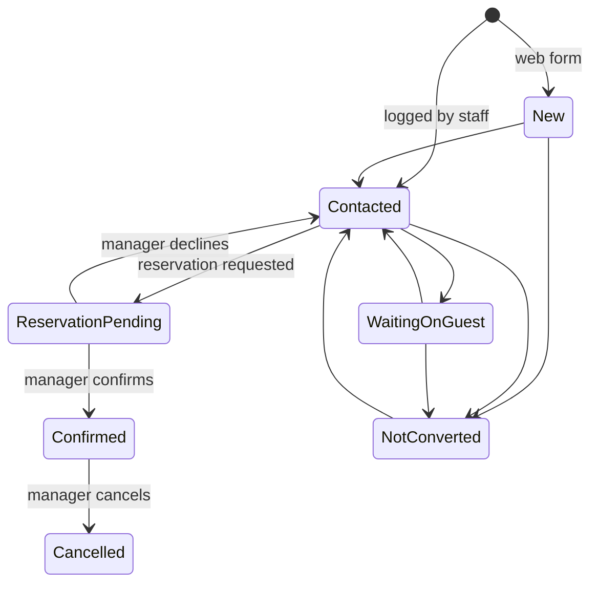

# Starwood SmartStay: design document

A showcase prototype for Starwood Gardens Hotel, built by Florante Tech Limited.
It demonstrates one journey end to end:

> campaign-tagged link, landing page and enquiry, staff follow-up, pending reservation,
> manager decision, and a manager view of which campaign produced what.

**Not claimed:** live room availability, rates, payments or a real booking engine. All data is
sample data. A pending reservation is never counted as confirmed.

## 1. Scope and journey coverage

| Journey step | What the prototype does | Where |
|---|---|---|
| Campaign link | Manager creates a campaign; it gets a tracked link and a QR code | Campaigns |
| Landing page | Offer page with an enquiry form; no account, no payment | `/promo/` |
| Enquiry | Saved with its campaign, source and medium | Guest form |
| Phone, walk-in, WhatsApp | Staff log enquiries that did not come through the web | Log an enquiry |
| Staff follow-up | Inbox, notes with follow-up times, assignment, status workflow | Staff area |
| Pending reservation | Reception requests a room for the guest, with capacity and date checks | Reservations |
| Manager decision | Only the Manager confirms, declines or cancels | Reservations |
| Campaign results | Enquiries, confirmed bookings, conversion, funnel and trend per campaign | Overview, Campaign performance |

## 2. Stack

| Layer | Choice | Why |
|---|---|---|
| Backend | Django 6.1, Python 3.14 | Mature, built-in auth, admin and migrations |
| Database | SQLite for the demo | Zero setup; swap to PostgreSQL for production |
| API | Django REST framework (one read-only endpoint) | Dashboard data as JSON, session-authenticated |
| Front end | Server-rendered templates, HTMX 2.0.4, Tailwind 3.4.17 (compiled) | No React; fast, simple, easy to hand over |
| Charts | HTML bars plus ApexCharts for the trend line | Every chart has a table view |
| Static files | WhiteNoise | One process serves the site and its assets |
| Tests | Django test runner, 55 tests | Rules are checked, not assumed |

## 3. Roles

| Role | Can do |
|---|---|
| Guest (anonymous) | View the landing page, submit an enquiry |
| Reception | Work enquiries, log phone and walk-in enquiries, request reservations |
| Manager | Everything Reception does, plus confirm, decline or cancel reservations, manage campaigns, see Campaign performance, assign enquiries to others |
| Superuser | Django admin only |

Roles are Django groups named `Reception` and `Manager`. Pages are protected by a
`role_required` decorator; a blocked user sees a friendly 403 page.

## 4. Attribution rules

The browser keeps the UTM tags for the session and posts them with the form. The **server** decides
the credit, so a guest cannot invent a source.

| Situation | Campaign | Source and medium |
|---|---|---|
| No tags | none | direct |
| Code matches an active campaign | that campaign | copied from the campaign record (guest-supplied values ignored) |
| Code matches nothing | none | unknown (raw value kept for review) |
| Source tag but no campaign code | none | unknown |
| Code matches a paused or ended campaign | none, guest sees an "offer ended" page | not recorded |
| Staff-entered, campaign chosen | that campaign | from the campaign |
| Staff-entered, no campaign | none | the channel (phone, walk-in, whatsapp) |

Chain of record: Campaign, then Enquiry, then Reservation. Campaigns with an end date switch off
automatically (checked on use, with `expire_campaigns` as a scheduled backup).

## 5. Enquiry status workflow

| From | Allowed next | Reason required |
|---|---|---|
| New | Contacted, Not converted, Cancelled | on Not converted, Cancelled |
| Contacted | Waiting on guest, Not converted, Cancelled | on Not converted, Cancelled |
| Waiting on guest | Contacted, Not converted, Cancelled | on Not converted, Cancelled |
| Not converted | Contacted | no |
| Reservation pending | none (moved only by the reservation) | n/a |
| Confirmed | none (moved only by the reservation) | n/a |
| Cancelled | none | n/a |

Reservation pending and Confirmed cannot be set by hand. They change only when a reservation is
requested or confirmed, so reporting cannot be flattered by a manual edit.



Reservation statuses: pending, confirmed, declined, cancelled. Only a pending reservation can be
confirmed or declined; only a confirmed one can be cancelled. Declining and cancelling need a reason.
Every change writes a history row (who, when, from, to, why).

## 6. Screens and URLs

| URL | Name | Who | Purpose |
|---|---|---|---|
| `/`, `/promo/` | home, promo | Guest | Landing page and enquiry form |
| `/thanks/` | enquiry_thanks | Guest | Confirmation with reference |
| `/staff/login/`, `/staff/logout/` | staff_login, staff_logout | Staff | Sign in and out |
| `/staff/` | staff_home | Staff | Overview; Manager also gets the Campaign performance tab |
| `/staff/inbox/` | staff_inbox | Staff | All enquiries, filters, search, My enquiries |
| `/staff/enquiries/new/` | staff_enquiry_new | Staff | Log a phone, walk-in or WhatsApp enquiry |
| `/staff/enquiries/<id>/` | staff_enquiry | Staff | Detail, notes, status, assignment |
| `/staff/enquiries/<id>/quick/` | staff_enquiry_quick | Staff | Side-panel preview |
| `/staff/enquiries/<id>/reserve/` | staff_reservation_create | Staff | Request a reservation |
| `/staff/reservations/` | staff_reservations | Staff | Reservation list by status |
| `/staff/reservations/<id>/` | staff_reservation | Staff (decisions: Manager) | Detail and decisions |
| `/staff/reservations/<id>/quick/` | staff_reservation_quick | Staff | Side-panel preview |
| `/staff/campaigns/` | staff_campaigns | Manager | Campaign list with counts |
| `/staff/campaigns/new/`, `<id>/edit/` | staff_campaign_new, staff_campaign_edit | Manager | Create and edit |
| `/staff/campaigns/<id>/quick/` | staff_campaign_quick | Manager | Side panel with link and QR |
| `/staff/campaigns/<id>/qr.svg` | staff_campaign_qr | Manager | QR code (`?download=1` to save) |
| `/staff/dashboard/` | staff_dashboard | Manager | Redirects to the performance tab |
| `/api/v1/dashboard/` | api_dashboard | Manager | JSON for the performance tab |

### API

`GET /api/v1/dashboard/?days=7|30|90|all`, Manager only, session-authenticated.
Returns `period`, `kpis` (enquiries, confirmed, conversion, waiting), `previous` (the prior period),
`by_campaign`, `funnel` (Received, Handled by staff, Reservation requested, Confirmed) and `trend`
(daily counts, zero days filled). Basis: enquiries received in the period. Responses are cached
privately for 15 seconds.

## 7. Data

| Table | Holds |
|---|---|
| `core_roomtype` | Room types with name, description, capacity, display order |
| `campaigns_campaign` | Name, unique code, source, medium, landing path, headline, offer, end date, active flag |
| `enquiries_enquiry` | Guest details, stay request, status, campaign, source, medium, raw campaign code, entry channel, owner |
| `enquiries_enquirynote` | Staff notes with an optional next follow-up time |
| `enquiries_statuschange` | Audit trail of every status change |
| `reservations_reservation` | A room request tied to one enquiry, with dates, guests and status |

Sample rows are flagged `is_sample`. References are `SG-0001` style. Times use Africa/Nairobi.

## 9. Setup

```bash
python -m venv .venv && source .venv/bin/activate
pip install -r requirements.txt
npm install                      # build tools only
npm run build                    # compile Tailwind (the built CSS is committed)
python manage.py migrate
python manage.py seed_demo       # rooms, 5 campaigns, ~60 enquiries, demo users
python manage.py runserver
```

Demo logins: `reception` and `manager`, password `demo12345`.

| Command | Use |
|---|---|
| `python manage.py reset_demo --yes` | Wipe demo leftovers and restore clean sample data (needs `DEMO_MODE`) |
| `python manage.py expire_campaigns` | Switch off campaigns past their end date (scheduled backup) |
| `python manage.py test core` | Run the 55 tests |
| `npm run watch` | Rebuild CSS while editing templates |

Settings read from the environment include `SITE_URL` (used in campaign links and QR codes) and
`DEMO_MODE`; see `config/settings.py` for the full list.

### Before hosting the demo
1. `DEBUG` off, a new `SECRET_KEY`, and `ALLOWED_HOSTS` set to the real domain.
2. `SITE_URL` set to the public address, otherwise QR codes point at 127.0.0.1.
3. Replace the demo passwords and use a strong superuser password.
4. Run `python manage.py collectstatic`, then serve over HTTPS (the Copy-link button needs it).

## 10. Tests

55 automated tests cover: status transitions and required reasons; the attribution rules above;
reservation lifecycle and Manager-only decisions; staff-entered enquiries; role access to pages and
the API; campaign expiry and the offer-ended page; the online group cap (12); friendly error pages;
compiled-CSS checks; and the demo reset.

## 11. Known limitations

- Sample content only; no live availability, rates or payments.
- The staff area is light mode only.
- Fonts load from Google Fonts, so the pages need internet access (self-host for offline use).
- Online enquiries are capped at 12 guests; larger groups are asked to call.
- A campaign start date is not modelled (campaigns have an end date only).

## 12. Open questions for the hotel

1. **Data protection.** Guest names and phone numbers are personal data under the Kenya Data
   Protection Act. How long should enquiries be kept, who may see them, and what consent wording
   should the form carry?
2. **Who sees which enquiries?** Today all staff see all enquiries; should Reception see only
   their own and unassigned ones?
3. **Assignment.** Managers can assign enquiries to anyone. Is that the right rule?
4. **Campaign start dates.** Do campaigns need a start date as well as an end date?
5. **Group bookings.** Is 12 the right online limit, and which number should the message show?
6. **Real inventory and payment.** Which system holds true availability, and is online payment wanted?
